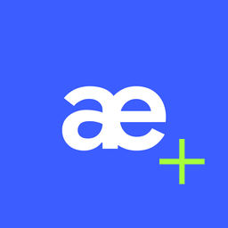

<div align="center">



# AEmulator Aster

**Старі прошивки Android — HTC Sense, TouchWiz, MIUI, AOSP — на сучасному телефоні. Без root і без ПК.**

[🇬🇧 English](../../README.md) · [🇷🇺 Русский](README.ru.md) · **🇺🇦 Українська** · [🇩🇪 Deutsch](README.de.md) · [🇫🇷 Français](README.fr.md) · [🇪🇸 Español](README.es.md) · [🇧🇷 Português](README.pt-BR.md) · [🇮🇹 Italiano](README.it.md) · [🇵🇱 Polski](README.pl.md) · [🇹🇷 Türkçe](README.tr.md) · [🇸🇦 العربية](README.ar.md) · [🇮🇷 فارسی](README.fa.md) · [🇮🇳 हिन्दी](README.hi.md) · [🇮🇩 Indonesia](README.id.md) · [🇻🇳 Tiếng Việt](README.vi.md) · [🇨🇳 简体中文](README.zh-CN.md) · [🇯🇵 日本語](README.ja.md) · [🇰🇷 한국어](README.ko.md)

</div>

---

AEmulator Aster завантажує справжню систему Android 2.3–7.x прямо з файлу прошивки: ZIP для рекавері, архіву Odin або factory-образу Google. Старий ARM-код транслює доопрацьований QEMU, binder ядра емулюється, графіка йде через GPU телефона, звук — через аудіосистему Android. Усе працює всередині звичайного застосунку.

## ✨ Можливості

- Імпорт майже будь-яких форматів: ZIP для CWM/TWRP, Odin `.tar.md5` від Samsung, factory `.tgz` від Google, `system.img`, OTA `system.new.dat.br`
- Оболонки виробників працюють як є: HTC Sense, Samsung TouchWiz, MIUI, AOSP
- Апаратна графіка через GL-міст, звук, дотики й мультитач, мережа із сучасним TLS-проксі
- Спільна папка «карти пам’яті» для APK, музики й фото
- Інтерфейс Material 3 Expressive 18 мовами
- Безкоштовно й з відкритим кодом (GPL-3.0)

## 🚀 Швидкий старт

1. Завантажте APK з [Releases](https://github.com/yuchenlin4827-hitch/AEmulator-Aster/releases) і встановіть.
2. Відкрийте AEmulator Aster → **Додати прошивку** й виберіть файл. Імпорт триває кілька хвилин.
3. Натисніть **Запустити**. Перше завантаження довше: система оптимізує застосунки.
4. Меню ⋮ — гучність, кнопка живлення й журнал; кнопка ⚙️ — налаштування й мова.

## 📋 Вимоги

- Android 8.0+ на 64-бітному ARM-телефоні (arm64-v8a)
- Близько 1–3 ГБ вільного місця на прошивку
- Рекомендовано сучасний Snapdragon / Dimensity / Tensor

## ⚙️ Як це влаштовано

Кожен процес гостя працює під доопрацьованим QEMU в режимі користувача. Демон binder замінює драйвер ядра, GL-міст передає виклики OpenGL ES на GPU телефона, а невеликі гостьові бібліотеки (звуковий HAL, обгортка audio policy, прошарок LD_PRELOAD) підлаштовують код виробників під емулятор. Імпортер читає прошивку, знаходить init-скрипти в boot-образі й будує план запуску системних служб.

## 🛠️ Збирання з вихідного коду

Перевірена збірка релізного застосунку використовує JDK 21 та Android SDK 36. Див. [інструкцію зі збірки та вихідного коду](../build-source.md), зокрема подробиці про нативний тулчейн і підпис. **Для успадкованих готових бінарників рушія досі немає підтвердженого повного походження вихідного коду та збірки**; див. [аудит](../license-audit.md).

```bash
git clone https://github.com/yuchenlin4827-hitch/AEmulator-Aster.git
cd AEmulator-Aster
./gradlew copyReleaseApks
```

## 🙏 Подяки

AEmulator Aster виріс з емуляторів HTC Desire HD та HTC One M7 [першого автора](https://t.me/istratiit_ech) — без його рушія проєкту б не було.

AEmulator Aster — модифікований форк [AEmulator Plus](https://github.com/somerandomusernam2/AEmulator-Plus), що базується на [drel4/AEmulator-Sunset](https://github.com/drel4/AEmulator-Sunset) і [uxazu/AEmulator](https://github.com/uxazu/AEmulator).

## 🔗 Посилання

- Мій форк: [yuchenlin4827-hitch/AEmulator-Aster](https://github.com/yuchenlin4827-hitch/AEmulator-Aster)
- AEmulator Plus: [somerandomusernam2/AEmulator-Plus](https://github.com/somerandomusernam2/AEmulator-Plus)
- Апстрим: [drel4/AEmulator-Sunset](https://github.com/drel4/AEmulator-Sunset)
- Оригінал: [uxazu/AEmulator](https://github.com/uxazu/AEmulator)
- Автор: [yuchenlin4827-hitch](https://github.com/yuchenlin4827-hitch)
- Перший автор: [t.me/istratiit_ech](https://t.me/istratiit_ech)

## 📄 Ліцензія

GPL-3.0. Android, торговельні марки й прошивки належать їхнім власникам.

Див. [датовані повідомлення про зміни](../../NOTICE.md) та [відкритий аудит вихідного коду й ліцензій](../license-audit.md). Позначка GPL не гарантує, що для кожного вбудованого готового бінарника є повний відповідний вихідний код.
